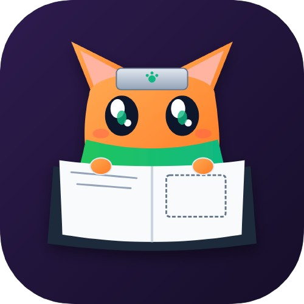

# Manga Reader App

<div align="center">



**Personal manga collection & reader — self-hosted, multi-source, offline-first.**

[](https://php.net)
[](https://mariadb.org)
[](https://getbootstrap.com)
[](https://github.com/features/actions)
[](LICENSE)

</div>

---

## ✨ Fitur Utama

| Kategori | Fitur |
|----------|-------|
| **Koleksi** | Grid/List view, search real-time, filter genre/favorit/custom tag, batch delete (admin) |
| **Detail Manga** | Multi-source binding (Shinigami, Komiku, CosmicScans, AsuraScans), preferred source, reading progress %, custom tags |
| **Reader** | Webtoon (scroll) / Single Page (tap), immersive UI (auto-hide chrome), progress bar, keyboard shortcuts, swipe gestures, image retry |
| **Discovery** | Pencarian publik multi-sumber, deduplication, infinite scroll, one-click add |
| **Statistik** | Chapter/manga count, estimasi waktu, velocity, streak (current/longest), genre favorit, top manga, heatmap 30 hari, recap bulanan/tahunan |
| **Notifikasi** | Telegram per-user (hanya manga favorit), cron daily notif chapter baru |
| **Automation** | GitHub Actions cron (daily sync, trending refresh), Telegram bot commands, keepalive workflow |
| **PWA** | Installable, service worker, offline shell, manifest + icons |
| **Auth** | Session-based, rate-limited login/register, avatar upload, password change, Telegram link |

---

## 🏗️ Arsitektur Singkat

```
┌─────────────────────────────────────────────────────────────┐
│  FRONTEND (PHP + Vanilla JS)                                │
│  index.php, manga.php, reader.php, discover.php, stats.php  │
├─────────────────────────────────────────────────────────────┤
│  CORE                                                       │
│  config.php, sync_functions.php, sources/ (Adapter Pattern) │
├─────────────────────────────────────────────────────────────┤
│  CRON (GitHub Actions + Playwright)                         │
│  cron_update.php, cron_trending.php, cron_notify_users.php  │
├─────────────────────────────────────────────────────────────┤
│  DATABASE (MySQL/MariaDB)                                   │
│  12 tables: mangas, chapters, users, reading_progress, etc. │
└─────────────────────────────────────────────────────────────┘
```

**Multi-Source Sync** — Adapter pattern: tambah sumber = 1 class + 1 line registry. Deduplication cross-source via `UNIQUE(manga_id, chapter_number)`.

---

## 🚀 Quick Start

### Prerequisites
- PHP 8.1+ (8.3 recommended)
- MySQL/MariaDB 10.5+
- Composer (optional, untuk dev dependencies)
- Web server (Apache/Nginx) atau PHP built-in server

### 1. Clone & Setup

```bash
git clone https://github.com/tommianggoro/manga-reader-app.git
cd manga-reader-app

# Copy env template
cp .env.example .env
# Edit .env dengan kredensial DB & secrets
```

### 2. Database

**Fresh install:**
```sql
-- Import schema.sql via phpMyAdmin / mysql CLI
mysql -u root -p < schema.sql
```

**Existing data (migrations):**
```bash
# Jalankan berurutan
mysql -u root -p < migration_multisource.sql
mysql -u root -p < migration_public_access.sql
mysql -u root -p < migration_tags.sql
mysql -u root -p < migration_telegram_chat_id.sql
mysql -u root -p < migration_sync_checkpoint.sql
```

### 3. First Admin

```sql
-- Setelah register via /register.php, jalankan:
UPDATE users SET is_admin = 1 WHERE username = 'username_kamu';
```

### 4. Run Locally

```bash
# PHP built-in server
php -S localhost:8000

# Atau Apache/Nginx dengan document root ke folder project
```

Akses: `http://localhost:8000`

---

## ⚙️ Konfigurasi (.env)

```env
# Database
DB_HOST=localhost
DB_NAME=manga_reader
DB_USER=root
DB_PASS=

# Cron secret (untuk webhook GitHub Actions)
CRON_SECRET_KEY=generate_random_string_here

# Site URL (digunakan cron & notifikasi)
SITE_URL=https://your-domain.com

# Telegram Bot (opsional, untuk notifikasi & bot)
TELEGRAM_BOT_TOKEN=123456:ABC-DEF...
TELEGRAM_CHAT_ID=123456789
TELEGRAM_ALLOWED_USERS=123456789,987654321

# Rate limiting (optional overrides)
MAX_LOGIN_ATTEMPTS=5
LOGIN_LOCKOUT_MINUTES=15
MAX_REGISTRATIONS_PER_WINDOW=3
REGISTRATION_WINDOW_MINUTES=60
```

> **Catatan**: InfinityFree shared hosting tidak support `pcntl_fork` — parallel sync hanya jalan di GitHub Actions (Linux).

---

## 🤖 GitHub Actions Automation

### Workflows

| File | Schedule (UTC) | WIB | Fungsi |
|------|----------------|-----|--------|
| `manga_cron.yml` | `0 16 * * *` | 23:00 | Sync chapter semua manga |
| `manga_trending_cron.yml` | `15 16 * * *` | 23:15 | Refresh trending cache |
| `telegram_poller.yml` | `*/5 * * * *` | — | Bot commands (/sync_now, /status) |
| `keepalive.yml` | `0 6 * * 0` | Minggu 13:00 | Prevent 60-day auto-disable |

### Required Secrets (Settings → Secrets → Actions)

| Secret | Deskripsi |
|--------|-----------|
| `CRON_SECRET_KEY` | Sama dengan `.env` |
| `SITE_URL` | URL production (contoh: `https://mangareader.infinityfreeapp.com`) |
| `TELEGRAM_BOT_TOKEN` | Dari @BotFather |
| `TELEGRAM_CHAT_ID` | Chat ID penerima notifikasi cron |
| `TELEGRAM_ALLOWED_USERS` | Comma-separated user ID yang boleh pakai bot |
| `GH_PAT` | (Opsional) Classic PAT scope `workflow` untuk manual trigger via API |

### Enable Workflows
1. Push ke GitHub → Actions tab → "I understand my workflows, go ahead and enable them"
2. Atau lewat Telegram bot: `/enable_cron`

---

## 📱 Telegram Bot Commands

| Command | Deskripsi |
|---------|-----------|
| `/sync_now` / `/sync` | Trigger manga + trending sync |
| `/sync_manga` | Sync manga only |
| `/sync_trending` | Trending only |
| `/enable_cron` | Enable scheduled workflows |
| `/disable_cron` | Disable scheduled workflows |
| `/status` | Cek status workflow |
| `/help` | Bantuan |

---

## 🗂️ Struktur Project

```
manga-reader-app/
├── index.php                 # Home: koleksi grid/list
├── manga.php                 # Detail manga + chapter list
├── reader.php                # Baca chapter (immersive)
├── discover.php              # Public search multi-source
├── stats.php                 # Dashboard statistik (auth)
├── profile.php               # Profil, avatar, telegram
├── login.php / register.php  # Auth pages
├── config.php                # DB, auth, constants
├── sync_functions.php        # Core sync logic (generic)
├── sources/                  # Adapter pattern
│   ├── MangaSourceInterface.php
│   ├── SourceRegistry.php
│   ├── ShinigamiSource.php
│   ├── KomikuSource.php
│   ├── CosmicScansSource.php
│   └── AsuraScansSource.php
├── cron_update.php           # Daily manga sync
├── cron_trending.php         # Daily trending refresh
├── cron_notify_users.php     # Per-user Telegram notif
├── telegram_poller.php       # GH Actions bot
├── .github/workflows/        # 4 workflow files
├── schema.sql                # Full schema (fresh)
├── migration_*.sql           # Incremental migrations
├── assets/                   # Icons, logo, avatars
├── partials/                 # login_modal.php
├── .claude/
│   ├── PRD.md                # Product Requirements
│   └── DESIGN.md             # Design System
└── README.md
```

---

## 🎨 Design System

- **Warna**: Dark charcoal `#10131a` + Amber `#f2a541` (bukan biru)
- **Tipografi**: Bitter (serif display) + Inter (sans body)
- **Komponen**: Card grid, list row, source chips, skeleton shimmer, toast, modal
- **Reader**: Dual layout, immersive chrome, progress bar, floating nav
- **Tokens**: CSS custom properties (`--bs-*`) — no hardcoded hex

Lihat lengkap: [.claude/DESIGN.md](.claude/DESIGN.md)

---

## 📋 Product Requirements

Lihat lengkap: [.claude/PRD.md](.claude/PRD.md)

---

## 🛠️ Development

### Add New Source
1. Buat class di `sources/` implement `MangaSourceInterface`
2. Daftarkan di `SourceRegistry.php::getAllSources()` (urutan: specific → fallback)
3. Selesai — sync logic & UI otomatis pakai source baru

### Code Style
- PSR-12 (PHP), ES6 (JS)
- CSS custom properties untuk semua warna/spacing
- Bootstrap 5 utility classes first, custom CSS minimal

### Run Tests
```bash
# Verify schema
php verify_schema.php

# Check decimal chapters
php check_decimal_chapters.php

# Dry-run cron (CLI)
php cron_update.php
```

---

## 📦 Deployment (InfinityFree)

1. Upload semua file ke `htdocs/`
2. Import `schema.sql` via phpMyAdmin
3. Set `.env` di root (di luar `htdocs` kalau bisa, atau protect via `.htaccess`)
4. Set `SITE_URL` ke domain InfinityFree
5. GitHub Actions secrets → enable workflows
6. Test: `https://your-domain.com/cron_update.php?key=CRON_SECRET_KEY`

> **Cloudflare Challenge**: InfinityFree pakai Cloudflare JS challenge. GitHub Actions pakai **Playwright (headless Chromium)** untuk bypass — lihat `manga_cron.yml`.

---

## 🔒 Security

- Rate limiting login (5 attempts → 15 min lockout) & registrasi (3/jam/IP)
- Admin-only endpoints: `requireAdmin()` check
- CSRF protection via same-site session cookies
- No SQL injection (prepared statements everywhere)
- Telegram webhook: verified via `TELEGRAM_ALLOWED_USERS`

---

## 🤝 Contributing

1. Fork → branch `feature/nama-fitur`
2. Commit dengan conventional commits: `feat:`, `fix:`, `chore:`, `docs:`
3. PR ke `master` dengan deskripsi jelas

---

## 📄 License

MIT License — see [LICENSE](LICENSE)

---

## 🙏 Acknowledgments

- **Sources**: Shinigami, Komiku, CosmicScans, AsuraScans — terima kasih sudah menyediakan konten manga gratis
- **Libraries**: Bootstrap, Bootstrap Icons, Playwright, DiceBear Avatars
- **Hosting**: InfinityFree (free shared hosting), GitHub Actions (free CI/CD)

---

<div align="center">

**Dibangun dengan ❤️ untuk komunitas pembaca manga Indonesia**

[Report Bug](https://github.com/tommianggoro/manga-reader-app/issues) · [Request Feature](https://github.com/tommianggoro/manga-reader-app/issues/new)

</div>